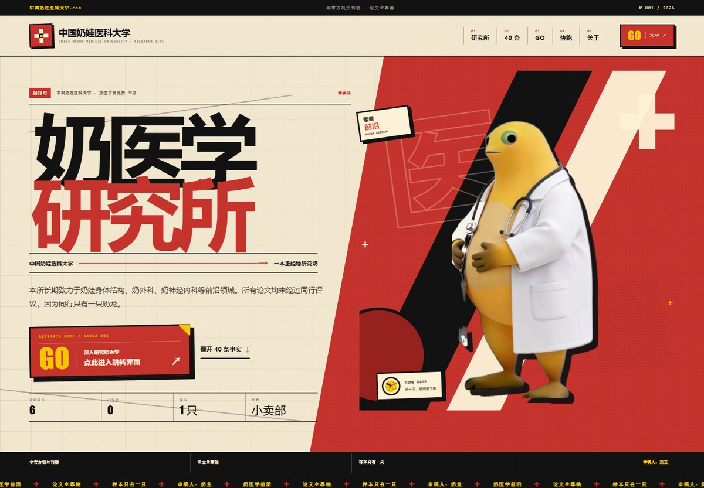
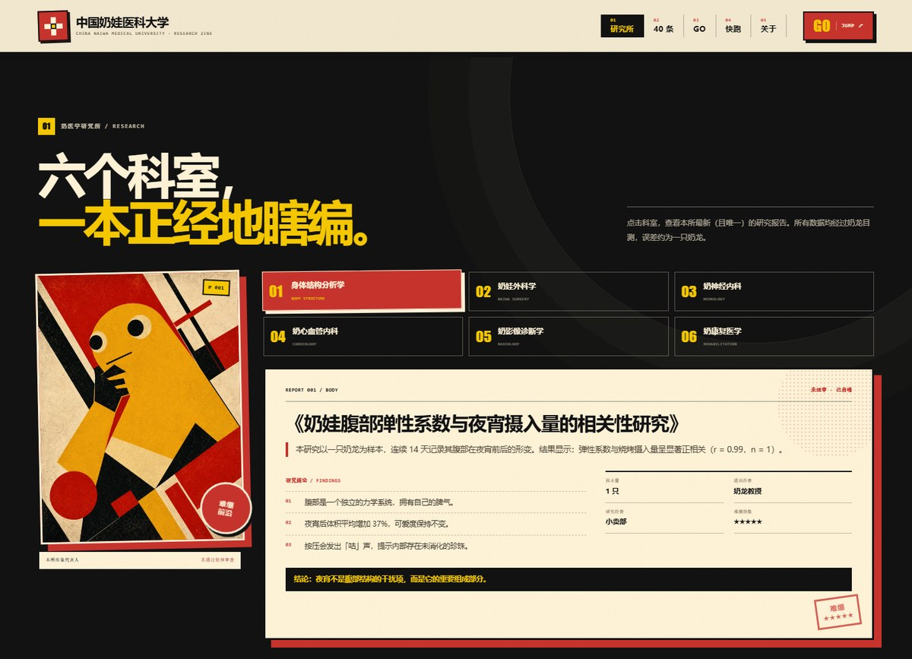
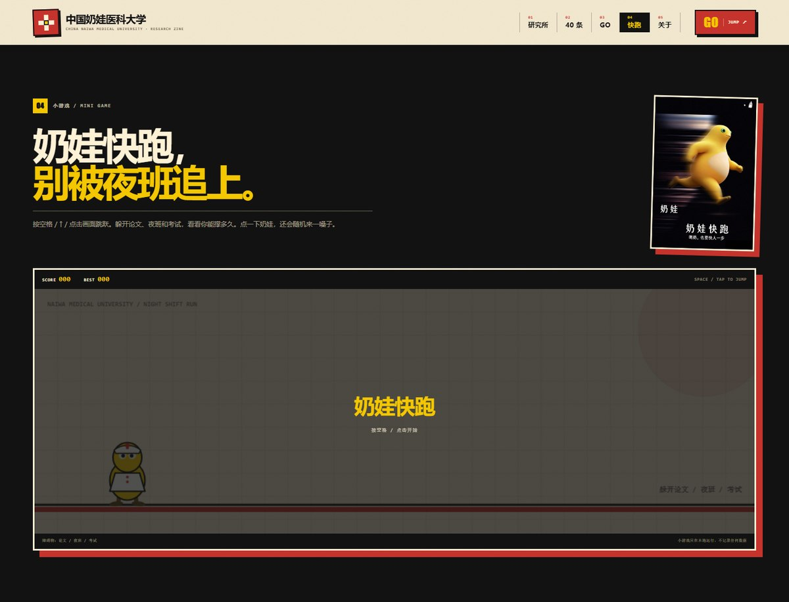
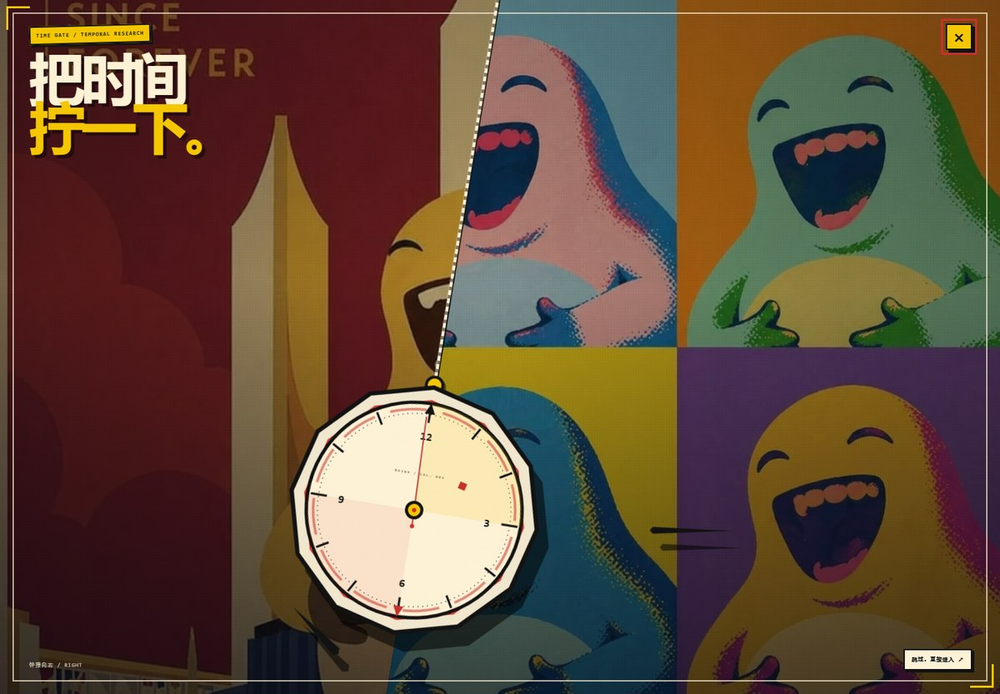
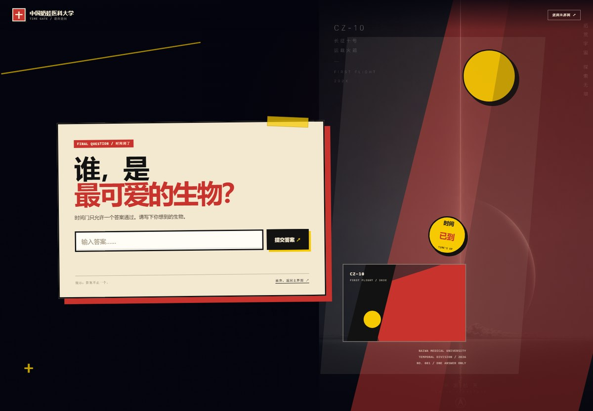

# 中国奶娃医科大学 · 奶医学研究所

一所只存在于网页里的虚构医科大学，一个一本正经瞎编的奶医学研究所。

- 域名：`https://中国奶娃医科大学.com/`（`xn--fiq06jptdmvcilg2ac5e371h.com`）
- 六个奶医学科室、40 个事实、GO 跳转界面、奶娃快跑小游戏
- 纯静态、零依赖、无构建步骤



## 页面里有什么

- **Hero**：`奶医学研究所`，样本只有一只奶龙，经费来自小卖部。
- **奶医学研究所**：六个可点击科室，每个科室一份瞎编研究报告：
  - 身体结构分析学
  - 奶娃外科学
  - 奶神经内科
  - 奶心血管内科
  - 奶影像诊断学
  - 奶康复医学
- **40 个事实**：39 条已证实 + 1 条「未完待续」。按网络流传的 39 条大学事实风格改编，全部为奶娃宇宙设定。
- **GO**：点此进入跳转界面，再由跳转界面前往昆明医科大学官网。
- **时间门**：主界面右下角的钟表图案、GO 区「先看一眼时间」或页脚「钟表」都能触发。钟表从主界面落成全屏吊表，长绳悬挂、左右摇摆，把画面分成左右两半；长绳就是左右画面的分割线，随钟摆大幅倾斜，左右画面随之收缩/扩张，并用四张图轮换。钟表在屏幕下方，随后上移放大、合上画面，进入次级提问页。
  - 奶龙 / 奶娃：播放「安迪」并返回主界面
  - 史迪奇：接受答案，返回主界面
  - 其他答案：显示「打错了」，退回时间门
- **奶娃快跑**：Chrome 小恐龙式跑酷，空格 / ↑ / 点击跳跃，躲开论文、夜班和考试；分数存本地，不记录其他数据。右侧配一张夜色奔跑海报。
- **奶娃语音彩蛋**：点击首屏医生、GO 区护士或跑酷海报，随机播放「安迪」「嘎嘎滴辣虾」「干巴蝶」之一，并在点击位置弹出文字。
- **P5 风格动态**：入场斜切 wipe、GO 分屏转场、斜切标签、硬阴影、荧光黄/红/黑构成主义配色。
- **移动端**：折叠菜单、研究科室两列、响应式跑酷画布。
- **免责声明**：页面底部明确标注非官方、与昆明医科大学无隶属关系、所有研究均为虚构。









## 本地预览

不需要安装依赖：

```powershell
cd naiwa-medical-university
python -m http.server 8900
# 打开 http://127.0.0.1:8900/
```

也可以直接双击 `index.html`。

### 演示模式

```text
http://127.0.0.1:8900/?stay
```

按 GO 只播放跳转过场，不会真的离开。

## 页面流程

```text
index.html
  → 点右下角钟表 / 「先看一眼时间」
  → 全屏吊表动画（落下、长绳摇摆、左右四图轮换）
  → 钟表上移放大合上
  → clock.html（CZ-10 背景提问页）
      → 奶龙 / 奶娃：播放安迪 → index.html
      → 史迪奇：接受答案 → index.html
      → 其他：显示「打错了」→ clock.html

index.html
  → 按 GO → 全屏跳转过场
  → exit.html（跳转界面，显示目标学校）
  → https://www.kmmc.cn/
```

- `index.html` 的正文不展示目标学校校名/校徽，只在 GO 区的小字和底部免责声明中说明去向。
- `exit.html` 负责最后一段跳转界面，并自动进入官网。
- 最终地址只写在 `exit.html` 中；主页面不需要改脚本里的 URL。

## 文件结构

```text
naiwa-medical-university/
├─ index.html                 页面（40 条事实已内联）
├─ exit.html                  跳转界面 / 自动进入官网
├─ timegate.css               主界面全屏吊表动画 / 左右分屏
├─ timegate.js                钟摆落下、长绳分屏、四图轮换、合上转场
├─ clock.html                 次级提问页（CZ-10 背景）
├─ clock.css                  次级页构成主义版式 / CZ-10 背景
├─ clock.js                   提问判定 / 安迪音效
├─ styles.css                 构成主义版式、P5 动效、研究 tabs、游戏
├─ script.js                  研究所切换、GO 过场、跑酷小游戏、奶娃语音
├─ CNAME                      GitHub Pages 自定义域名
├─ assets/
│  ├─ naiwa-doctor.png          透明背景白大褂奶娃医生（PNG）
│  ├─ naiwa-nurse-card.png     护士帽奶娃护士肖像卡（用户提供图片）
│  ├─ naiwa-run-poster.jpg     奶娃快跑夜景海报
│  ├─ space/cz10.webp         次级页 CZ-10 背景
│  ├─ timegate/
│  │  ├─ fair.webp             世界博览会奶龙海报
│  │  ├─ pop.webp              波普六宫格
│  │  ├─ lying.webp            趴着的奶娃
│  │  └─ sitting.webp          托腮奶娃
│  ├─ audio/
│  │  ├─ andi.mp3              安迪
│  │  ├─ mai.mp3               明媚烈焰 / 嘎嘎滴辣虾
│  │  └─ ganbadie.mp3          干巴蝶
│  ├─ constructivist-illustration.webp  构成主义插图
│  ├─ favicon.svg             站点图标
│  └─ og-cover.jpg            1200×630 分享卡片
├─ preview/                   页面预览图
└─ README.md
```

## 修改内容

- 六个科室的研究报告：直接编辑 `index.html` 里的 `.lab-panel`。
- 40 条事实：直接编辑 `.fact-grid` 里的 `.fact` 条目；第 040 条是「未完待续」占位。
- 跳转地址：修改 `exit.html` 里的 `meta refresh`、`立即进入` 链接和脚本中的 `location.replace`。
- 分享图：替换 `assets/og-cover.jpg`（1200×630）。
- 图片：替换 `assets/naiwa-doctor.png / assets/naiwa-nurse-card.png` 即可。

## 用 GitHub Pages 部署

### 1. 建仓库

在 GitHub 新建一个 **Public** 仓库，例如 `naiwa-medical-university`。

不要把整个 `naiwa-medical-university/` 文件夹传上去；要把**文件夹里面的内容**放到仓库根目录：

```text
仓库根目录/
├─ index.html
├─ exit.html
├─ styles.css
├─ script.js
├─ timegate.css
├─ timegate.js
├─ clock.html
├─ clock.css
├─ clock.js
├─ CNAME
├─ assets/
├─ preview/        （可选）
└─ README.md
```

### 2. 上传

网页上传：仓库首页 → **Add file** → **Upload files**，把上面这些文件和文件夹拖进去，提交到 `main`。

或者用 Git 命令行：

```bash
cd naiwa-medical-university
git init
git add .
git commit -m "deploy naiwa medical university"
git branch -M main
git remote add origin https://github.com/<你的用户名>/<仓库名>.git
git push -u origin main
```

### 3. 开启 Pages

仓库 **Settings → Pages**：

- **Source**：`Deploy from a branch`
- **Branch**：`main`
- **Folder**：`/ (root)`
- 点 **Save**

等 1–2 分钟，先确认默认地址能打开：

```text
https://<你的用户名>.github.io/<仓库名>/
```

如果这个地址正常，再做下一步自定义域名。

### 4. 绑定自定义域名

`CNAME` 文件已经写好：

```text
xn--fiq06jptdmvcilg2ac5e371h.com
```

这是 `中国奶娃医科大学.com` 的 punycode。GitHub Pages 的自定义域名建议填 **punycode**，不要填中文。

**Settings → Pages → Custom domain** 填入：

```text
xn--fiq06jptdmvcilg2ac5e371h.com
```

保存后 GitHub 会检查 DNS。不要删仓库里的 `CNAME` 文件。

### 5. 配 DNS

在域名注册商 / DNS 服务商处配置。`中国奶娃医科大学.com` 是根域名（apex），需要 **A 记录**：

| 类型 | 主机记录 | 记录值 |
| --- | --- | --- |
| A | `@` | `185.199.108.153` |
| A | `@` | `185.199.109.153` |
| A | `@` | `185.199.110.153` |
| A | `@` | `185.199.111.153` |

如果需要 IPv6，再加：

| 类型 | 主机记录 | 记录值 |
| --- | --- | --- |
| AAAA | `@` | `2606:50c0:8000::153` |
| AAAA | `@` | `2606:50c0:8001::153` |
| AAAA | `@` | `2606:50c0:8002::153` |
| AAAA | `@` | `2606:50c0:8003::153` |

`www` 子域可加：

| 类型 | 主机记录 | 记录值 |
| --- | --- | --- |
| CNAME | `www` | `<你的用户名>.github.io` |

注意：

- 如果域名上还有旧的 **URL 转发 / 301**，先拆掉，否则页面可能永远打不开。
- 如果使用 Cloudflare，先设为 **DNS only（灰云）**，等 GitHub 的 HTTPS 证书签发后再考虑代理。
- 根域名的 A 记录不要和旧服务器 IP 混在一起。

### 6. 开 HTTPS

DNS 生效后回到 **Settings → Pages**：

- 等 **Custom domain** 显示 DNS check successful
- 勾选 **Enforce HTTPS**
- 证书可能要几分钟到 24 小时

### 7. 验收

浏览器打开：

```text
https://中国奶娃医科大学.com/
```

或直接测 punycode：

```powershell
curl.exe -I https://xn--fiq06jptdmvcilg2ac5e371h.com/
```

检查：

- 返回 `200`，不是 301 到别的地址
- 首页能加载 `assets/naiwa-doctor.png`
- 点 GO 能进入 `exit.html`，再进入官网
- `https://中国奶娃医科大学.com/exit.html` 能打开
- GitHub Pages 的 **Enforce HTTPS** 已勾选

### 常见问题

| 现象 | 原因 |
| --- | --- |
| 404 | 文件不在仓库根目录，或 Pages 分支/目录选错 |
| 只有 README 能开 | 把外层文件夹传成了仓库根目录，`index.html` 不在根目录 |
| 一直 301 | 域名上还有旧转发 / Cloudflare 规则 |
| 证书一直 pending | DNS 未生效，或 `CNAME` 与自定义域名不一致 |
| 图片 404 | 大小写不对，或 `assets/` 没有一起上传 |
| 中文域名打不开 | DNS / Pages 里要用 punycode：`xn--fiq06jptdmvcilg2ac5e371h.com` |

### 其他静态托管

- **Cloudflare Pages**：Framework preset 选 `None`，Build command 留空，上传本目录。
- **Netlify / Vercel**：作为静态站点导入，输出目录指向本目录。

页面资源使用相对路径，放在子目录也能正常打开。

## 说明

- 中国奶娃医科大学是虚构校名，不提供学历、课程、论文或医疗服务。
- 所有奶医学研究、数据、科室、结论均为虚构，不构成医疗建议。
- 本站为非官方粉丝整活页面，与昆明医科大学无隶属关系。
- 页面不收集个人信息，游戏最高分只保存在浏览器本地。
- 校名、校徽等权利归昆明医科大学所有；奶龙形象权利归原权利人所有。

## 参考

- 跳转页结构灵感：[Enderman112/nailong-university](https://github.com/Enderman112/nailong-university)
- 栏目与「大学事实」形式参考：[奶龙医科大学.work](https://xn--ekrs1lzg04eny8d9m9b.work/)
- 奶医学科室的虚构方式参考：[Milk Dragon University](https://www.milkdragonuniversity.me/)
- 39 条事实的原始结构参考：[知乎文章](https://zhuanlan.zhihu.com/p/115743820)
- 构成主义插图与两只奶娃图片由用户提供
